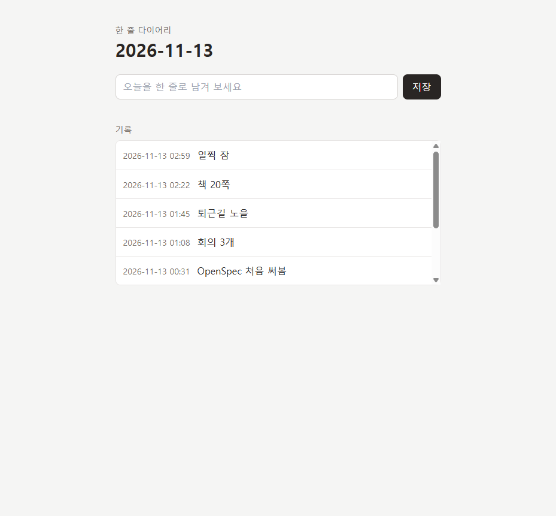
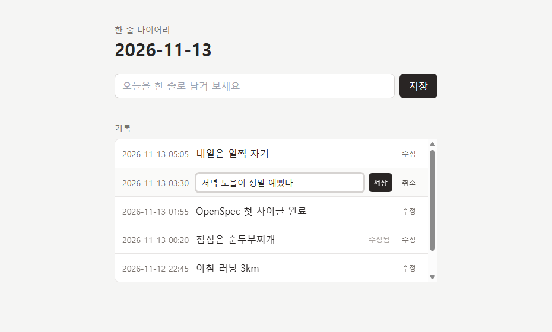

# ✍️ 한 줄 다이어리

> 하루를 딱 한 줄로. 설치도, 가입도, 서버도 없이 브라우저 하나로 쓰는 다이어리.




<details>
<summary>✏️ 수정 화면 보기</summary>



</details>

---

## 목차

- [왜 한 줄인가](#왜-한-줄인가)
- [주요 기능](#주요-기능)
- [빠른 시작](#빠른-시작)
- [사용법](#사용법)
- [프로젝트 구조](#프로젝트-구조)
- [데이터 저장 방식](#데이터-저장-방식)
- [설계 원칙](#설계-원칙)
- [OpenSpec 개발 흐름](#openspec-개발-흐름)
- [로드맵](#로드맵)
- [알려진 제약](#알려진-제약)

---

## 왜 한 줄인가

일기는 길게 쓰려는 순간 미루게 됩니다. 한 줄이면 부담이 없고, 쌓이면 그대로 하루하루의 기록이 됩니다. 이 앱은 **쓰는 데 5초, 보는 데 1초**를 목표로 꼭 필요한 것만 담았습니다.

## 주요 기능

| 기능 | 설명 |
|---|---|
| 📅 **오늘 날짜 자동 표시** | 화면을 열면 `2026-12-31` 형식으로 오늘 날짜가 보입니다. 기기의 **로컬 시간** 기준이라 한국에서 새벽에 써도 전날 날짜로 밀리지 않습니다. |
| ✏️ **한 줄 입력** | 최대 100자. 저장 버튼이나 **Enter** 키로 바로 저장합니다. 앞뒤 공백은 자동으로 정리됩니다. |
| 🔁 **하루 여러 번 작성** | 같은 날 몇 번이든 쓸 수 있고, 기록마다 작성 시간(`HH:mm`)이 함께 남습니다. |
| ⚠️ **빈칸 경고** | 내용 없이 저장하면 입력칸 아래에 "내용을 입력해 주세요."가 뜹니다. 다시 입력하면 사라지고, 경고가 떠도 화면이 들썩이지 않습니다. |
| 🛠️ **목록에서 바로 수정** | 각 기록의 [수정]을 누르면 그 줄이 입력칸으로 바뀝니다. Enter·[저장]으로 저장, Esc·[취소]로 되돌립니다. 지난 기록도 고칠 수 있습니다. |
| 🏷️ **수정됨 표시** | 내용이 실제로 바뀐 기록에만 "수정됨"이 붙습니다. 처음 쓴 날짜·시간과 목록 순서는 그대로이며, 표시에 마우스를 올리면 수정 시각이 보입니다. |
| 📜 **최신순 목록** | 모든 기록을 최신순으로 보여줍니다. 5개를 넘으면 목록 영역 안에서만 스크롤됩니다. |
| 💾 **새로고침해도 유지** | 브라우저 `localStorage`에 저장되어 창을 닫았다 열어도 남아 있습니다. |
| 🇰🇷 **한글 입력 대응** | 한글 조합 중 누른 Enter로 같은 글이 두 번 저장되지 않습니다. |
| 🛡️ **안전한 표시** | 입력한 내용은 글자 그대로 표시되어 `<script>` 같은 HTML이 실행되지 않습니다. |

## 빠른 시작

준비물은 **최신 브라우저** 하나입니다. Node.js, npm, 빌드 모두 필요 없습니다.

```bash
git clone https://github.com/Song-eungi/diary-openspec.git
cd diary-openspec
```

다음 중 편한 방법으로 엽니다.

**방법 1. VS Code Live Server (권장)**
`index.html`을 우클릭 → **Open with Live Server**

**방법 2. Python 내장 서버**
```bash
python -m http.server 5173
```
브라우저에서 <http://127.0.0.1:5173/> 접속

**방법 3. 파일 직접 열기**
`index.html`을 더블클릭해 브라우저로 엽니다 (`file://`). 대부분 동작하지만 브라우저에 따라 저장소 동작이 다를 수 있어 방법 1·2를 권장합니다.

> 💡 Tailwind를 CDN에서 불러오므로 인터넷 연결이 필요합니다. 오프라인이면 스타일만 빠지고 기능은 그대로 동작합니다.

## 사용법

1. 화면 맨 위에서 오늘 날짜를 확인합니다.
2. 입력칸에 오늘을 한 줄로 적습니다.
3. **Enter**를 누르거나 **저장** 버튼을 누릅니다.
4. 방금 쓴 기록이 목록 맨 위에 나타납니다.
5. 긴 기록은 목록에서 말줄임으로 보이며, 마우스를 올리면 전체 내용을 볼 수 있습니다.

**기록 고치기**

1. 고칠 기록 오른쪽의 **수정**을 누릅니다.
2. 그 줄의 입력칸에서 내용을 고치고 **Enter** 또는 **저장**을 누릅니다.
3. 그만두려면 **Esc** 또는 **취소**를 누릅니다. 다른 기록의 **수정**을 눌러도 지금 편집은 저장되지 않고 닫힙니다.
4. 내용을 모두 지우고 저장하면 입력칸이 빨갛게 표시되며 저장되지 않습니다.

## 프로젝트 구조

```
diary-openspec/
├── index.html              # 화면 마크업 (Tailwind 클래스)
├── app.js                  # 날짜 처리 · 저장소 · 렌더링 · 이벤트
├── docs/
│   ├── screenshot.png      # README 스크린샷
│   └── screenshot-edit.png # 수정 화면 스크린샷
├── openspec/
│   ├── config.yaml         # OpenSpec 설정 (산출물 한국어)
│   ├── specs/
│   │   └── diary-entries/  # ✅ 확정된 동작 스펙
│   └── changes/
│       └── archive/        # 완료된 변경의 기획 문서
├── .githooks/
│   └── post-commit         # 커밋 시 자동 push
└── .claude/ · .agents/     # OpenSpec 워크플로 스킬
```

### `app.js` 한눈에 보기

```
 [페이지 로드]
      |
      v
 loadEntries() ---- 손상 데이터면 diary.entries.corrupt 로 백업 후 []
      |
      v
 renderList() ----> 최신순 정렬 -> <li> 생성 (textContent)
      ^               editingId 인 기록은 편집 행으로
      |               스크롤 위치·편집 중 내용 보존
      |
      +---- startEdit / finishEdit / handleEditSave  <- [수정]·[취소]·Esc·편집 폼 submit
      |
 handleSave() <---- submit (버튼 / Enter)
      |
      +-- 빈 값이면 경고 표시 후 종료
      +-- {id, date, time, text, createdAt} 추가
      +-- saveEntries() 실패 시 alert, 입력 유지
```

## 데이터 저장 방식

- **위치**: 브라우저 `localStorage`
- **키**: `diary.entries`
- **값**: 기록 객체의 JSON 배열

```json
[
  {
    "id": "537752ce-8597-4b76-a007-cf27e06dce70",
    "date": "2026-11-13",
    "time": "11:33",
    "text": "커피 마심",
    "createdAt": 1794537190582,
    "updatedAt": 1794537790582
  }
]
```

| 필드 | 용도 |
|---|---|
| `id` | 기록 고유값. 이후 수정·삭제 기능의 기준 (`crypto.randomUUID()`, 미지원 환경은 대체 생성) |
| `date`, `time` | 저장 시점의 로컬 날짜·시간을 **고정**해 표시. 나중에 시간대가 바뀌어도 쓴 당시 그대로 |
| `text` | 앞뒤 공백을 제거한 내용 (최대 100자) |
| `createdAt` | 정렬용 밀리초 타임스탬프. 같은 분에 쓴 기록도 순서가 정확함 |
| `updatedAt` | (선택) 마지막 수정 시각. 있으면 "수정됨" 표시. 수정하지 않은 기록에는 없음 |

> ⚠️ 기록은 **이 브라우저에만** 있습니다. 다른 기기와 공유되지 않으며, 브라우저의 사이트 데이터를 지우면 함께 사라집니다.

## 설계 원칙

- **빌드 없음** — 파일을 열면 바로 동작. ES 모듈 대신 일반 스크립트를 써서 `file://`에서도 열립니다.
- **로컬 시간 우선** — `toISOString()`(UTC)을 쓰지 않고 로컬 날짜를 직접 조립합니다.
- **입력 흐름을 끊지 않기** — 빈칸 경고는 `alert()` 대신 인라인 문구로 띄웁니다. 편집 줄에서는 줄 높이가 변하지 않도록 빨간 테두리와 입력칸 안 문구로 알립니다.
- **기록의 시점 지키기** — 수정해도 처음 쓴 날짜·시간은 바꾸지 않고 수정 시각을 따로 남깁니다.
- **데이터 보호** — 저장된 값이 깨져 있어도 앱이 멈추지 않고, 원본은 백업해 둡니다.

자세한 결정 배경은 각 변경의 `design.md`에 있습니다: [작성](openspec/changes/archive/2026-11-13-add-diary-write/design.md) · [수정](openspec/changes/archive/2026-11-13-add-diary-edit/design.md)

## OpenSpec 개발 흐름

이 프로젝트는 [OpenSpec](https://github.com/Fission-AI/OpenSpec)으로 **스펙을 먼저 쓰고 구현**합니다.

```
 explore  -->  propose  -->  apply  -->  archive
 (탐색)        (기획 문서)    (구현)      (스펙 확정)
```

| 단계 | 명령 (Claude Code) | 결과물 |
|---|---|---|
| 탐색 | `/openspec-explore` | 요구사항 정리 |
| 제안 | `/openspec-propose <change>` | `proposal.md` · `specs/` · `design.md` · `tasks.md` |
| 구현 | `/openspec-apply-change <change>` | 코드 + 작업 체크 |
| 보관 | `/openspec-archive-change <change>` | `openspec/specs/`에 스펙 반영 |

### 완료된 변경

| 날짜 | 변경 | 내용 |
|---|---|---|
| 2026-11-13 | [`add-diary-write`](openspec/changes/archive/2026-11-13-add-diary-write/) | 오늘 날짜 표시, 한 줄 작성, 빈칸 경고, 최신순 목록 |
| 2026-11-13 | [`add-diary-edit`](openspec/changes/archive/2026-11-13-add-diary-edit/) | 목록에서 바로 수정, 수정됨 표시 |

### 현재 스펙

- [`diary-entries`](openspec/specs/diary-entries/spec.md) — 요구사항 13개 · 시나리오 34개

## 로드맵

- [x] 한 줄 작성 · 최신순 목록 (`add-diary-write`)
- [x] 기록 수정 (`add-diary-edit`)
- [ ] 기록 삭제
- [ ] 날짜별 묶어 보기 · 검색
- [ ] JSON 내보내기 / 가져오기 (백업)
- [ ] 자정을 넘기면 상단 날짜 자동 갱신
- [ ] Tailwind CLI 빌드로 전환 (배포용)

## 알려진 제약

- Tailwind **Play CDN**은 개발용이라 브라우저 콘솔에 경고가 한 줄 뜹니다. 배포 단계에서 CLI 빌드로 바꿀 예정입니다.
- 페이지를 연 채로 자정을 넘기면 상단 날짜는 갱신되지 않습니다. (저장되는 기록의 날짜는 정확합니다.)
- 브라우저 저장소에만 보관하므로 기기 간 동기화는 지원하지 않습니다.

## 기여하기

이 저장소는 커밋 시 자동으로 push하는 훅을 씁니다. clone 후 한 번 켜 주세요.

```bash
git config core.hooksPath .githooks
```

새 기능은 위 [OpenSpec 개발 흐름](#openspec-개발-흐름)대로 change를 만들어 제안해 주세요.
